<!-- ═══════════════════════ HEADER ═══════════════════════ -->

  <picture></picture>

  

  <picture></picture>
  
  

<!-- ═══════════════════════ ABOUT ═══════════════════════ -->
<h2 align="center">🧑‍💻 About Me</h2>

  <picture><source media="(prefers-color-scheme: light)" srcset="https://raw.githubusercontent.com/ABDULAHAD118/ABDULAHAD118/refs/heads/main/assets/about-light.svg" /></picture>

<!-- ═══════════════════════ CONNECT ═══════════════════════ -->
<h2 align="center">🌐 Connect With Me</h2>

  
  
  
  
  
  

<picture></picture>

<!-- ═══════════════════════ TECH STACK ═══════════════════════ -->
<h2 align="center">🛠️ Tech Stack</h2>

  <picture><source media="(prefers-color-scheme: light)" srcset="https://raw.githubusercontent.com/ABDULAHAD118/ABDULAHAD118/refs/heads/main/assets/tech-stack-light.svg" /></picture>

<picture></picture>

<!-- ═══════════════════════ STATS ═══════════════════════ -->
<h2 align="center">📊 GitHub Stats</h2>

  <picture><source media="(prefers-color-scheme: light)" srcset="https://github-readme-stats.vercel.app/api?username=abdulahad118&show_icons=true&theme=tokyonight&hide_border=false&border_color=d0d7de&bg_color=ffffff&title_color=7f5af0&icon_color=2cb67d&text_color=24292f&count_private=true" /></picture>
  <picture><source media="(prefers-color-scheme: light)" srcset="https://github-readme-stats.vercel.app/api/top-langs?username=abdulahad118&layout=compact&theme=tokyonight&hide_border=false&border_color=d0d7de&bg_color=ffffff&title_color=7f5af0&text_color=24292f&langs_count=8" /></picture>

  <picture><source media="(prefers-color-scheme: light)" srcset="https://streak-stats.demolab.com?user=abdulahad118&theme=default&hide_border=false&border=d0d7de&background=ffffff&ring=7f5af0&fire=00d4ff&currStreakLabel=2cb67d" /></picture>

<!-- ═══════════════════════ SNAKE ═══════════════════════ -->
<h2 align="center">🐍 Contribution Snake</h2>

  <picture>
    <source media="(prefers-color-scheme: dark)" srcset="https://raw.githubusercontent.com/ABDULAHAD118/ABDULAHAD118/refs/heads/output/github-snake-dark.svg" />
    
  </picture>

<!-- ═══════════════════════ QUOTE + FOOTER ═══════════════════════ -->

  <picture><source media="(prefers-color-scheme: light)" srcset="https://quotes-github-readme.vercel.app/api?type=horizontal&theme=light" /></picture>

  <i>⭐ If you like my work, drop a star on a repo — it keeps me shipping! ⭐</i>

  <picture></picture>

